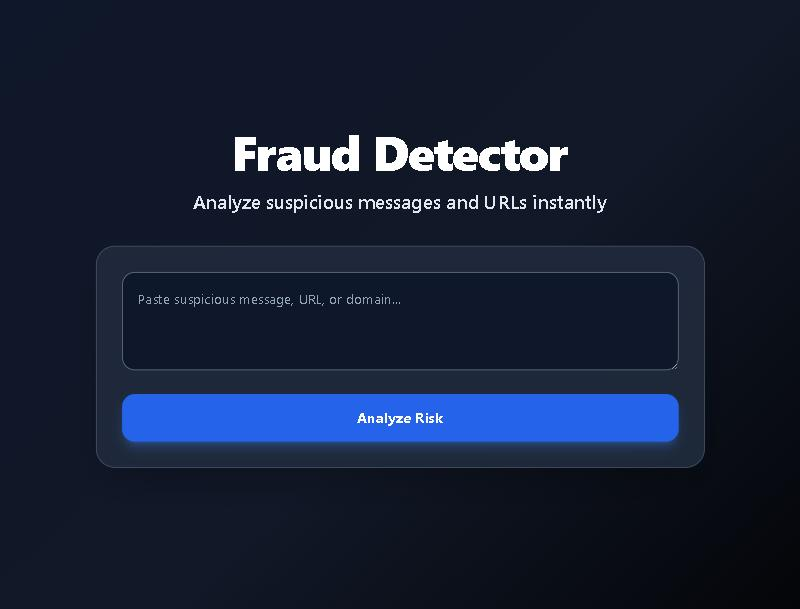
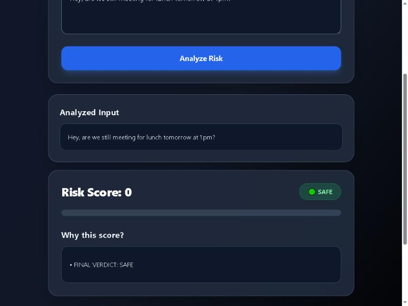
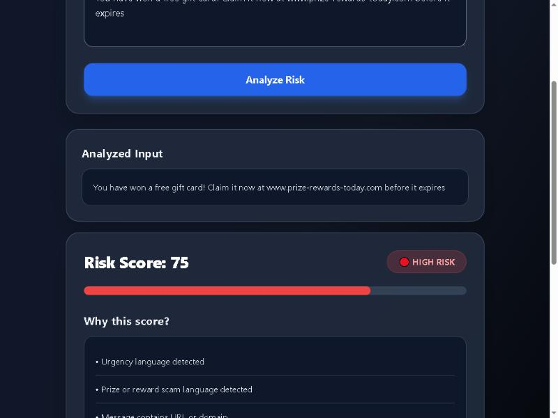
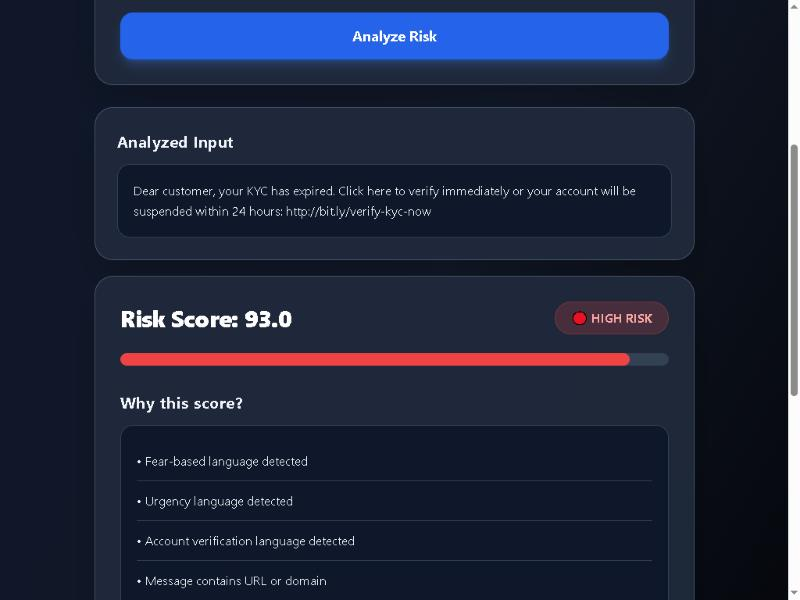

# Fraud Detector

**Analyze suspicious messages and URLs instantly — a rule-based fraud & scam detection engine with a live web app and Chrome extension.**

🔗 **Live demo:** [frauddetector.in](https://frauddetector.in)
👤 **Built by:** Piyush Verma — [LinkedIn](https://www.linkedin.com/in/-piyush-verma) · [GitHub](https://github.com/Piyush-Verma-07)

> Full source code is kept in a private repository to protect ongoing commercial use of this product. This repo is a technical showcase — architecture, design decisions, and results. **Source access is available on request for recruiters and interviewers.**

---

## What it does

Paste a message, a URL, or both — the engine returns a **0–100 risk score**, a **verdict** (Safe / Suspicious / High Risk), and **plain-language reasons** explaining exactly why.

Unlike most "AI fraud detector" demos, this is **not an LLM call wrapped in a UI.** It's a fully rule-based scoring engine — every signal, every weight, and every reason shown to the user is deterministic and explainable, which matters for a trust & safety tool where "the AI said so" isn't good enough.

| Input | Result |
|---|---|
| `Hey, are we still meeting for lunch tomorrow at 1pm?` | **Risk Score: 0 — SAFE** |
| `You have won a free gift card! Claim it now at www.prize-rewards-today.com before it expires` | **Risk Score: 75 — HIGH RISK** (urgency language, prize/reward scam language, suspicious URL) |
| `Dear customer, your KYC has expired. Click here to verify immediately... http://bit.ly/verify-kyc-now` | **Risk Score: 93 — HIGH RISK** (fear-based language, urgency language, account verification language, shortened URL, HTTP instead of HTTPS, uncommon TLD) |

---

## Screenshots

**Homepage**


**Safe message**


**High risk — prize scam**


**High risk — KYC phishing with shortened URL**


---

## Key highlights

- **Multi-signal rule-based scoring** — independent detection signals for text (urgency, fear/threat language, KYC/verification requests, prize/reward and investment scam patterns) and for URLs (domain structure, typosquatting, brand impersonation, shortened-link detection, suspicious TLDs, HTTP-vs-HTTPS)
- **Real threat-intelligence integration** — cross-checks against Google Safe Browsing, AbuseIPDB, and WHOIS/domain-age data; provider outages are handled gracefully and reported as a separate *analysis-completeness* level instead of silently affecting the risk score
- **One engine, three clients** — a versioned internal API layer is shared by the web app, a Chrome extension, and (in earlier iterations) an Android client, so detection logic can never silently drift between surfaces
- **Privacy-first by design** — no raw submitted message or URL is ever persisted to storage; results live only in a short-lived session for the redirect-after-submit cycle, then are gone
- **Careful, incremental architecture evolution** — the current (V2) detection pipeline was built and rolled out *side-by-side* with the original (V1) version behind a separate route, tested in isolation, and only promoted once verified — rather than a risky in-place rewrite
- **Production security hardening** — HSTS and standard security headers, environment-gated secure session cookies, `HttpOnly`/`SameSite` cookie flags, request-size limits and safe error handling on all API routes
- **Structured, traceable logging** — every analysis request is logged with a unique request ID at each lifecycle stage (started / completed / rejected / errored), without ever logging the submitted content itself
- **Evaluated, not just vibes** — tested against a 150+ case labeled corpus to measure precision and false-positive rate, with measured false negatives driving targeted signal improvements

## Tech stack

**Backend:** Python, Flask, Gunicorn (production WSGI)
**Detection:** Custom rule-based scoring engine (no external ML/LLM dependency for detection)
**Threat intel:** Google Safe Browsing API, AbuseIPDB, WHOIS/domain-age lookup
**Frontend:** Jinja2 templates, Tailwind CSS
**Client surfaces:** Web app, Chrome extension
**Testing:** pytest, custom evaluation harness against a labeled scam/safe message corpus

## Architecture (high level)

```
┌─────────────┐     ┌─────────────┐
│   Web App   │     │   Chrome    │
│   (/, /v2)  │     │  Extension  │
└──────┬──────┘     └──────┬──────┘
       │                   │
       │     shared API layer
       │   (validation, contracts,
       │    error handling, logging)
       └─────────┬─────────┘
                  │
           ┌──────▼──────┐
           │ Orchestrator │
           └──────┬──────┘
                  │
     ┌────────────┼────────────┐
     │            │            │
┌────▼────┐  ┌────▼────┐  ┌────▼────┐
│  Text    │  │   URL    │  │ Threat   │
│ Signals  │  │ Signals  │  │  Intel   │
│          │  │          │  │Providers │
└──────────┘  └──────────┘  └──────────┘
```

The web app and the Chrome extension both talk to the same internal orchestrator and API contract layer — they can never fall out of sync with each other, by construction rather than by discipline.

*(Signal weighting and scoring logic are intentionally not detailed here — that's the part of the product that's commercially sensitive. Happy to walk through it live in an interview.)*

## Why rule-based, not an LLM wrapper

Fraud/scam detection needs to be **explainable and auditable** — a user (or a regulator) can ask "why was this flagged?" and deserves a real answer, not a hallucination-prone model's guess. Building this as a deterministic, testable rule engine means every verdict can be traced back to specific, reproducible signals — and it can be evaluated with precision/recall like any other classifier, which is exactly what the 150+ case evaluation corpus was built to do.

---

## Want to see the full source?

I keep the production codebase in a private repository to protect the live product. If you're reviewing this as part of a hiring process, I'm glad to grant temporary read access or walk through the code live — just reach out.
